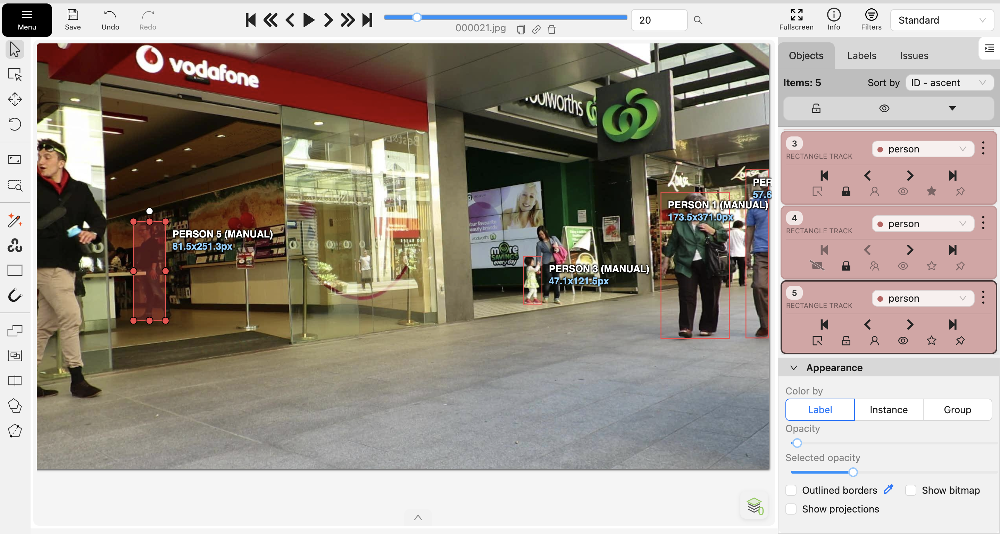
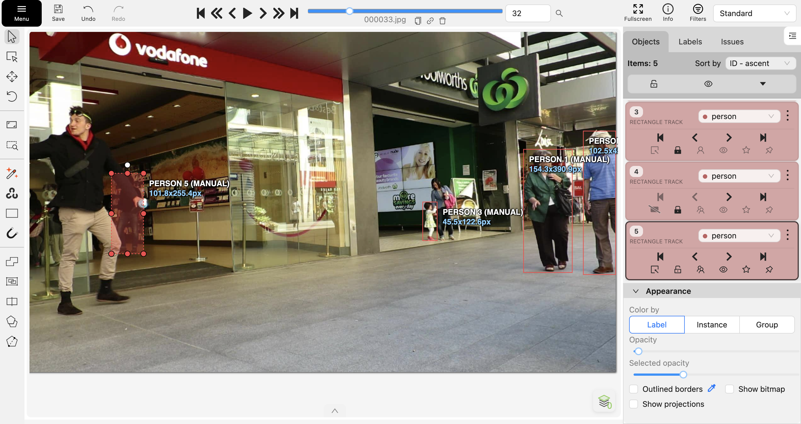
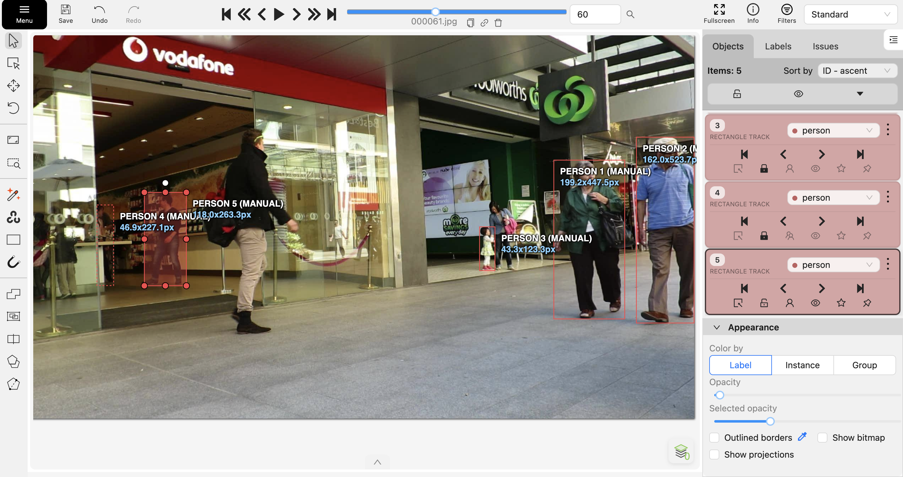

# Báo cáo cá nhân — Trần Quang Vinh-2A202603054

Đoạn video: MOT17-09, 150 frame (frame 1–150), nguồn MOTChallenge, giấy phép CC BY-NC-SA 3.0.

## 0. Thông tin học viên

- Họ tên: Trần Quang Vinh
- MSSV: 2A202603054
- Mã đề (A/B/C): A
- Email: 26ai.vinhtq4@vinuni.edu.vn
- Link repository: https://github.com/gloryTran04/K5-L2-DAY05-TranQuangVinh-2A202603054-MOTTracking
- Giờ bắt đầu: 16:15
- Giờ kết thúc: 19:30

## 1. Xem trước đoạn video (CP0)

Ghi **trước khi vẽ**, mỗi người một dòng.

| Mã | Frame xuất hiện | Frame cuối thấy được | Rẽ / dừng / đổi tốc độ ở frame | Bị che ở frame | Ghi chú |
|---|---|---|---|---|---|
| P1 | 0 | 149 | Đi chậm sang phải trong shop 0–24; từ ~55 đi về phía camera, to dần; ~110–149 đi chậm | Bị người áo khoác đen, quần kaki (ngoài 5 người) che: một phần 26–38, mất hẳn 39–43, một phần 44–54 | Áo len đen, quần jean, đeo kính; trong shop Vodafone |
| P2 | 59 | 149 | Đứng ở quầy 59–65; từ ~66 đi về phía camera, hơi sang phải; chậm lại và đổi hướng nhẹ ~110 | 59–62 bị người đàn ông đứng ở quầy che một phần; trước 59 không thấy | Áo trắng sọc cam, quần đen; đi gần bên trái P1 |
| P3 | 0 | 149 | Đi sang trái và lại gần camera suốt đoạn, box to lên nhanh nhất ở 100–149 | Không bị che; đi sát P4 | Áo khoác xanh lá, túi đen |
| P4 | 0 | 149 | 0–~25 đi vào từ mép phải ảnh (chỉ thấy một phần người); sau đó đi cạnh P3 về phía camera, to dần | Không bị người khác che; bị mép ảnh cắt ở 0–~25 | Áo xanh dương, mũ trắng, quần nâu |
| P5 | 0 | 146 | Đi chậm sang phải 0–~35, sau đó đứng gần như yên ~35–146 | Bị P3 che: một phần 106–110, mất hẳn 111–134, hiện lại 135; bị P4 che một phần 143–146, mất hẳn 147–149 | Bé gái váy xanh nhạt, giày đỏ, đứng cạnh mẹ (người mẹ không thuộc 5 người) |

## 2. Keyframe và thời gian (CP1, CP4)

Số keyframe lấy từ kết quả `src/check_submission.py`.

| Mã | Số keyframe | Keyframe ở frame | Số frame có mặt | Keyframe / 100 frame | Thời gian (phút) | Chỗ khó |
|---|---|---|---|---|---|---|
| P1 | 12 | 0, 12, 24, 26, 44, 55, 70, 85, 100, 115, 130, 149 | 145 | 8,3 | 30 | Bị che 26–54; phải ước lượng box toàn thân phía sau người che |
| P2 | 11 | 59, 63, 66, 75, 90, 100, 110, 120, 130, 140, 149 | 91 | 12,1 | 30 | Xuất hiện giữa video sau người đàn ông ở quầy; box phải bao cả phần bị che |
| P3 | 11 | 0, 10, 20, 30, 40, 60, 80, 100, 120, 140, 149 | 150 | 7,3 | 50 | Lại gần camera nên box to lên ngày càng nhanh |
| P4 | 13 | 0, 5, 10, 15, 20, 25, 40, 60, 80, 100, 120, 140, 149 | 150 | 8,7 | 60 | Đi vào từ mép phải, box rộng ra không đều ở 0–25 |
| P5 | 11 | 0, 20, 40, 70, 105, 106, 110, 135, 136, 138, 143 | 123 | 8,9 | 60 | Người nhỏ (rộng ~45–60 px), bị che hai lần |
| **Tổng** | **58** | | **659** | **8,8** | **230** | |

Keyframe ở bảng trên lấy từ kết quả `src/check_submission.py` (chỉ đếm keyframe có box, không tính keyframe `outside`).

Keyframe / 100 frame của cả bài = tổng keyframe ÷ tổng số frame có mặt × 100 = 58 ÷ 659 × 100 ≈ 8,8.

Bạn đặt keyframe nhiều nhất ở người nào? Vì sao (người đó rẽ, dừng, lại gần camera hay bị che)?

Nhiều nhất là P4 (13 keyframe). Ở frame 0–25 P4 đang đi vào từ mép phải nên phần người nằm trong ảnh rộng ra rất nhanh và không đều; nội suy tuyến tính giữa hai keyframe cách xa sẽ làm box hụt hoặc thừa, nên tôi đặt keyframe mỗi 5 frame ở đoạn này. Sau frame 25 P4 đi thẳng đều về phía camera nên chỉ cần keyframe mỗi 15–20 frame. P1 và P2 cũng cần keyframe dày quanh đoạn bị che (P1: 24, 26, 44, 55; P2: 59, 63, 66).

## 3. Đoạn bị che (CP2)

Người bị che: `P1` (ID 5 trên CVAT), bị người áo khoác đen, quần kaki đi ngang tiền cảnh che. Người che không thuộc 5 người nên không gán.

| Mốc | Frame |
|---|---:|
| Bắt đầu bị che một phần (bật `occluded`) | 26 |
| Mất hẳn (bật `outside`) | 39 |
| Hiện lại (tắt `outside`) | 44 |
| Thấy rõ trở lại (tắt `occluded`) | 55 |

- Thời gian khuất hẳn: 5 frame (39–43) = 5 ÷ 30 ≈ 0,17 giây.
- Quyết định: giữ cùng ID.
- Lý do (trả lời 3 câu: khuất bao lâu so với 60 frame, ngoại hình có khớp, chỗ hiện lại có đúng hướng và tốc độ):

1. Khuất hẳn 5 frame, ít hơn rất nhiều so với ngưỡng 60 frame (2 giây) của lớp.
2. Ngoại hình khớp: cùng áo len đen, quần jean, đeo kính, cùng chiều cao.
3. Chỗ hiện lại đúng hướng và tốc độ: trước khi bị che P1 đi chậm sang phải; ở frame 44 quần jean của P1 lộ ra dưới ba lô người che, đúng vị trí mà box nội suy giữa frame 24 và 55 dự đoán; sau đó P1 tiếp tục đi theo hướng cũ.

Trong đoạn 26–38 và 44–54 box vẫn bao toàn thân ước lượng của P1 (amodal), không co theo phần nhìn thấy. Trong file MOT 1.1, P1 không có dòng nào ở frame CVAT 39–43 (`frame_id` 40–44), còn các frame `occluded` vẫn có dòng.

Ngoài P1, P5 (bé gái) cũng bị che hai lần và được xử lý cùng cách: mất hẳn 111–134 (24 frame ≈ 0,8 giây, ít hơn 60 frame, cùng ngoại hình, đứng yên tại chỗ) nên giữ cùng ID; mất hẳn lần hai 147–149 đến hết video.

Ảnh chụp màn hình (nguồn ảnh: MOT17, MOTChallenge (Milan et al., 2016)):





Ảnh 1: frame 20, P1 (ID 5) chưa bị che. Ảnh 2: frame 32, box P1 nét đứt và cờ `occluded` bật trên card ID 5. Ảnh 3: frame 60, P1 hiện lại vẫn là ID 5.

## 4. Tự review ID (CP3)

Lượt 1 theo người (đi ngược từ frame 149 về 0 trên CVAT), lượt 2 theo cảnh (nhảy 10 frame). Ít nhất 3 dòng; không có lỗi thì ghi một dòng "đã kiểm hai lượt, không lỗi".

Loại lỗi dùng đúng một trong 7 mã: `id_switch`, `fragmentation`, `lost`, `merge`, `false_track`, `drift`, `flag`.

Số frame ghi theo CVAT (0–149). Mã người ↔ ID track trên CVAT: P1 = 5, P2 = 4, P3 = 1, P4 = 2, P5 = 3.

| Frame | Mã người | Loại lỗi | Mô tả một câu | Phát hiện ở lượt | Đã sửa? |
|---:|---|---|---|---|---|
| 63 | P2 | `flag` | P2 đã hiện rõ sau khi người đàn ông ở quầy dịch đi nhưng keyframe 63 vẫn còn cờ `occluded` (thừa cờ). | Lượt 1 (theo người) | Có: tắt `occluded` ở 63, chỉ giữ `occluded` ở 59–62 |
| 59–63 | P2 | `drift` | Keyframe 59 co box theo phần nhìn thấy (rộng 16 px) còn keyframe 63 lấn sang cột kính (rộng 79 px), nên box nội suy ở 60–62 lệch khỏi người. | Lượt 1 (theo người) | Có: chỉnh box 59 và 63 về cỡ toàn thân, rộng khoảng 47 px |
| 110 | P5 | `lost` | Bật `outside` sớm 1 frame: ở frame 110 vẫn thấy một dải váy của bé phía sau người P3 nhưng track đã ẩn. | Lượt 1 (theo người) | Có: frame 110 để `occluded`, `outside` từ 111 |
| 135 | P5 | `lost` | Tắt `outside` muộn 1 frame: ở frame 135 mặt bé đã ló ra sau túi của P3 nhưng track vẫn ẩn. | Lượt 1 (theo người) | Có: tắt `outside` ở 135, giữ `occluded` đến 137 |

Sau khi sửa, đã kiểm lại cả hai lượt: không còn `id_switch`, `fragmentation`, `merge`, `false_track`; không có frame nào box nhảy xa (tâm dịch hơn nửa chiều cao box) hay chiều cao box đổi quá 30% trong 1 frame; hai track bất kỳ chồng nhau tối đa IoU 0,04.

Tổng hợp số lỗi theo loại:

| `id_switch` | `fragmentation` | `lost` | `merge` | `false_track` | `drift` | `flag` |
|---:|---:|---:|---:|---:|---:|---:|
| 0 | 0 | 2 | 0 | 0 | 1 | 1 |

Ghi chú quyết định: ở frame 39–41, giữa hai chân người che (người áo khoác đen, không thuộc 5 người) chỉ lộ mũi giày của P1, quá nhỏ để coi là "thấy một phần thân", nên vẫn giữ `outside` cho P1 ở 39–43; đến 44 thấy rõ quần jean của P1 nên tắt `outside`. Tương tự, ở frame 147 chỉ lộ mũi giày đỏ của P5 sau chân P4, nên giữ `outside` cho P5 từ 147 đến hết.

Lỗi nào chỉ lượt 2 (theo cảnh) mới thấy, lượt 1 (theo người) không thấy? Vì sao?

Trong job này lượt 2 không phát hiện thêm lỗi mới; 4 lỗi trên đều thấy ở lượt 1 vì cả 4 nằm ở mốc che khuất, nơi lượt 1 đi chậm từng frame trên một người. Lượt 2 dùng để bắt những lỗi mà lượt 1 không thể thấy, vì lượt 1 mỗi lần chỉ hiện một track: `false_track` (box của người ngoài 5 người, ví dụ người áo khoác đen che P1, người mẹ áo xám cạnh P5, cô gái áo xanh nhạt ở frame 140–149), người có trong khung mà không có box nào, và hai người đi sát bị tráo ID cho nhau (P3–P4 ở frame 100–149, P1–P2 trong shop). Ở lượt 2 tôi xác nhận: không có box thừa; mỗi người giữ đúng một ID ở mọi màn; P1 không có box ở 39–43 và P5 không có box ở 111–134, 147–149 là đúng vì họ bị che hoàn toàn; P5 hiện lại ở 135 giữa P3 và P4 với cùng ID.

## 5. File xuất và kết quả tự kiểm (CP4)

| Kiểm tra | Kết quả |
|---|---|
| Tên file MOT 1.1 | `src/exports/TranQuangVinh_mot.zip` (chỉ có `gt/gt.txt`, `gt/labels.txt`, không kèm ảnh) |
| Tên file CVAT for video 1.1 | `src/exports/TranQuangVinh_cvat_video.zip` (chỉ có `annotations.xml`, không kèm ảnh) |
| Số track ID khác nhau trong `gt/gt.txt` (phải là 5) | 5 |
| Frame `outside` không có dòng trong `gt.txt` (đúng / sai) | Đúng: P1 (track 4) không có dòng ở `frame_id` 40–44; P5 (track 3) không có dòng ở `frame_id` 112–135 và 148–150 |
| Job đã completed trên CVAT máy cá nhân | Có (job #15, task `DAY05-MOT17-09-A-2A202603054`, state `completed`) |

Đối chiếu ID giữa các file:

| Mã | ID trên CVAT | `track_id` trong `gt.txt` (MOT 1.1) | Track trong `annotations.xml` |
|---|---:|---:|---:|
| P1 | 5 | 4 | 4 |
| P2 | 4 | 5 | 3 |
| P3 | 1 | 1 | 0 |
| P4 | 2 | 2 | 1 |
| P5 | 3 | 3 | 2 |

Dán phần tóm tắt in ra từ `src/check_submission.py`:

```text
Số frame in theo CVAT (bắt đầu từ 0). Trong gt.txt, frame_id = frame CVAT + 1.

=== File MOT 1.1: TranQuangVinh_mot.zip ===
  Số track ID: 5   |   Tổng số box: 659
  [OK]        Đúng 5 track ID.

  Track | Frame có mặt | Số frame | Đoạn vắng (outside)
      1 |   0–149      |      150 | -
      2 |   0–149      |      150 | -
      3 |   0–146      |      123 | 111–134
      4 |   0–149      |      145 | 39–43
      5 |  59–149      |       91 | -


=== File CVAT for video 1.1: TranQuangVinh_cvat_video.zip ===

  Track | Nhãn   | Frame thấy | Keyframe | KF/100 frame | Frame occluded | Lần bật outside
      0 | person |        150 |       11 |          7.3 |              0 |               0
              Track 0: keyframe ở frame [0, 10, 20, 30, 40, 60, 80, 100, 120, 140, 149]
      1 | person |        150 |       13 |          8.7 |              0 |               0
              Track 1: keyframe ở frame [0, 5, 10, 15, 20, 25, 40, 60, 80, 100, 120, 140, 149]
      2 | person |        123 |       11 |          8.9 |             12 |               2
              Track 2: keyframe ở frame [0, 20, 40, 70, 105, 106, 110, 135, 136, 138, 143]
      3 | person |         91 |       11 |         12.1 |              4 |               0
              Track 3: keyframe ở frame [59, 63, 66, 75, 90, 100, 110, 120, 130, 140, 149]
      4 | person |        145 |       12 |          8.3 |             24 |               1
              Track 4: keyframe ở frame [0, 12, 24, 26, 44, 55, 70, 85, 100, 115, 130, 149]

  Tổng: 58 keyframe / 659 frame có mặt = 8.8 keyframe / 100 frame
  [OK]        Đọc được 5 track từ annotations.xml.

=== Tóm tắt ===
  Lỗi: 0   |   Cảnh báo: 0
  Đạt. Dán phần tóm tắt này vào báo cáo mục 5.
```

## 6. Ba câu kết

1. Nếu được gán lại, bạn sẽ đặt keyframe khác ở đâu? Vì sao?

   Ở P2 tôi sẽ đặt keyframe đầu tiên ở frame 63, nơi cô đã hiện rõ, rồi mới lùi về 59 và giữ cùng cỡ box. Lần này tôi vẽ ngay ở 59 khi cô đang bị người đàn ông ở quầy che nên box bị co theo phần nhìn thấy (rộng 16 px), sau đó lại sửa quá tay ở 63 (rộng 79 px), sinh ra lỗi `drift` ở 59–63. Ở P1 cách làm hiệu quả là đặt keyframe ở hai frame còn thấy rõ ngay trước và sau đoạn che (24 và 55) trước, để nội suy cho sẵn box ước lượng, rồi mới bật cờ ở 26, 39, 44; tôi sẽ dùng cách này cho mọi người bị che ngay từ đầu, kể cả P5. Ngược lại, ở P5 keyframe 70 gần như thừa vì bé đứng yên từ ~35 đến 105, box ở 40, 70 và 105 gần như trùng nhau, nên có thể bỏ.

2. Có chỗ nào bạn không chắc "cùng ID hay ID mới"? Bạn đã quyết định và ghi chú thế nào?

   Về danh tính thì tôi chắc chắn ở cả hai đoạn che: P1 khuất hẳn 5 frame (39–43) và P5 khuất hẳn 24 frame (111–134), đều dưới ngưỡng 60 frame, cùng ngoại hình (P1 áo len đen, quần jean, đeo kính; P5 váy xanh nhạt, giày đỏ) và hiện lại đúng chỗ theo hướng đi cũ (P5 đứng yên tại chỗ), nên giữ cùng ID. Chỗ tôi không chắc là ranh giới giữa "che một phần" và "mất hẳn": ở P1 frame 39–41 và P5 frame 147 chỉ lộ mũi giày, còn ở P5 frame 110 lộ một dải váy và frame 135 lộ mặt. Tôi chọn quy tắc: chỉ lộ mũi giày thì coi là mất hẳn (`outside`), thấy được một mảng thân, quần áo hoặc mặt thì là che một phần (`occluded`). Theo quy tắc đó tôi sửa P5 thành `occluded` ở 110 và 135, và ghi chú quyết định ở mục 4. Một chỗ khác là P2: trước frame 59 cô có thể đã đứng sau người đàn ông ở quầy nhưng không nhìn thấy, nên tôi bắt đầu track từ frame đầu tiên thấy được là 59 thay vì đoán ngược về trước.

3. Một lỗi ID trong job của bạn (nếu không còn sót, chọn lỗi đã sửa) có thể làm xe tự lái dự đoán sai chuyển động của người đó như thế nào? Lỗi đó ảnh hưởng MOTA hay IDF1 nhiều hơn?

   Tôi chọn lỗi `lost` đã sửa ở P5: bé gái hiện lại ở frame 135 từ sau người P3 nhưng track vẫn đang `outside`. Nếu tracker học từ nhãn như vậy, nó sẽ học rằng một đứa trẻ bước ra từ sau người lớn thì chưa cần có mặt ngay, tức nhận lại trẻ chậm. Với xe tự lái, trẻ em lộ ra từ sau người lớn là tình huống nguy hiểm nhất, nên chậm dù một vài frame cũng là chậm phanh. Nếu tệ hơn, tôi xoá box rồi vẽ track mới cho bé ở 135 (`fragmentation`), thì lịch sử chuyển động của bé (đứng yên từ ~35 đến 110) bị mất; track mới bắt đầu với vận tốc chưa biết nên mô-đun dự đoán quỹ đạo phải đoán lại từ đầu và có thể coi bé là một người mới đang di chuyển. Về chỉ số, hai frame `lost` (110 và 135) là 2 FN. Với khoảng 659 box GT, MOTA giảm 2/659 ≈ 0,30%, còn IDF1 giảm từ 1 xuống 2·657/(2·657 + 2) ≈ 0,9985, tức chỉ khoảng 0,15%. Vậy lỗi này ảnh hưởng MOTA nhiều hơn, vì FN bị cộng thẳng vào tử số của MOTA, còn IDF1 có mẫu số gấp đôi số box đúng. Ngược lại, nếu là `fragmentation` hay `id_switch` kéo dài (ví dụ tráo ID giữa P3 và P4 đi sát nhau ở 100–149) thì IDF1 bị phạt nặng hơn nhiều, vì cả đoạn sau mang ID sai đều thành IDFP và IDFN, trong khi MOTA chỉ tính 1 IDSW.

## Bonus (nếu làm)

Không làm bonus (B1, B2, B3).

## 7. Tài liệu tham khảo và công cụ AI đã dùng

- Tài liệu của lab: `RULES.md`, `docs/GUIDELINE.md`, `CHECKPOINTS.md`, `docs/MOT_FORMAT.md`, `docs/CVAT_CHEATSHEET.md`.
- Dữ liệu: MOT17, MOTChallenge (Milan et al., 2016), giấy phép CC BY-NC-SA 3.0. Ảnh chụp màn hình trong báo cáo lấy từ MOT17 trên CVAT máy cá nhân.